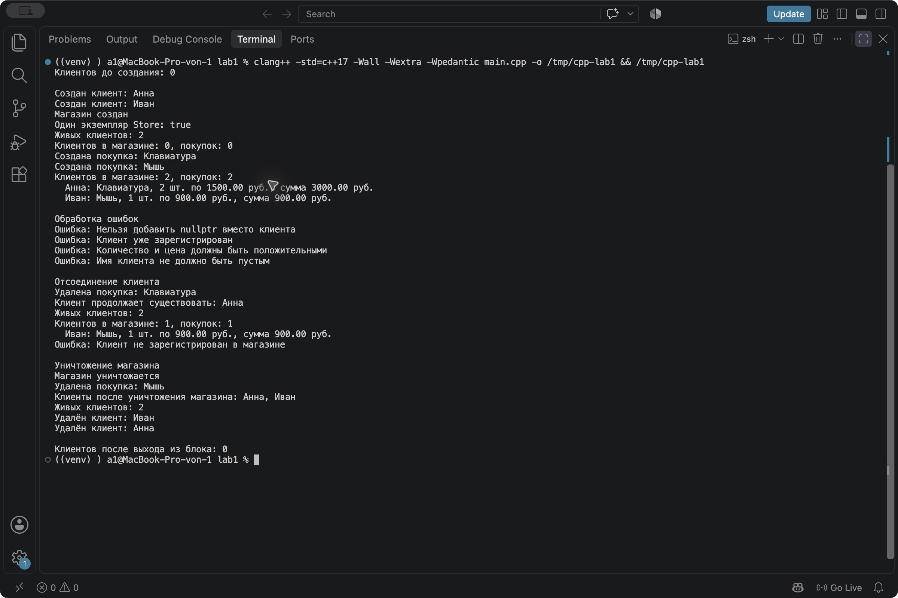

# Лабораторная работа № 1

Композиция и агрегация классов. Статические члены.

Дисциплина - Алгоритмы и структуры данных  
Студент - Осипов Герман Юрьевич  
Группа - ПИЖ-б-о-25-2  
Вариант - 10  
Уровень - продвинутый  
Год - 2026

## Содержание

- [Цель работы](#цель-работы)
- [Теоретическая часть](#теоретическая-часть)
- [Постановка задачи](#постановка-задачи)
- [Реализация](#реализация)
- [Сборка и запуск](#сборка-и-запуск)
- [Листинг программы](#листинг-программы)
- [Результаты работы](#результаты-работы)
- [Контрольные вопросы](#контрольные-вопросы)
- [Вывод](#вывод)
- [Репозиторий](#репозиторий)

## Цель работы

Научиться связывать классы через композицию и агрегацию, учитывать время жизни объектов и применять статические поля и методы. Реализовать Singleton на примере интернет-магазина.

## Теоретическая часть

Композиция означает владение частью. Когда объект-владелец уничтожается, принадлежащие ему части тоже удаляются. В программе магазин владеет покупками через unique_ptr.

При агрегации объект хранит связи с независимыми частями. Клиенты создаются отдельно от магазина. Store хранит их адреса и использует данные клиентов, а за их время жизни отвечает код в main().

Ассоциация описывает взаимодействие объектов без обязательного владения. В Purchase хранится указатель на покупателя, чтобы вывести его имя.

Статическое поле существует в одном экземпляре для всего класса. Customer::count хранит количество живых клиентов. Статический метод getCount() позволяет получить это значение без создания клиента.

Singleton предоставляет доступ к единственному экземпляру класса. У Store закрыты конструктор и деструктор, а копирование запрещено. Объект получается через getInstance(), освобождается через destroyInstance().

## Постановка задачи

Вариант 10 продвинутого уровня - система интернет-магазина.

Нужно реализовать Store как Singleton, Customer с отношением агрегации и Purchase с отношением композиции. Добавить статический счётчик объектов одного из классов и продемонстрировать все возможности.

В качестве владельца покупок выбран Store. Клиент и покупка связаны указателем на покупателя.

## Реализация

| Класс | Назначение | Хранение и время жизни |
| --- | --- | --- |
| Customer | Имя клиента и общий счётчик клиентов | Локальные объекты в main() |
| Purchase | Товар, покупатель, количество и цена | Создаются внутри Store и принадлежат ему |
| Store | Список клиентов и покупок | Единственный динамический экземпляр |

Вектор customers содержит указатели на клиентов. Магазин не вызывает для них delete. Перед уничтожением зарегистрированного клиента нужно отсоединить его через removeCustomer() либо уничтожить магазин. В демонстрации оба клиента живут дольше магазина.

Вектор purchases содержит unique_ptr. После удаления элемента из этого вектора или уничтожения Store вызывается деструктор соответствующей покупки.

removeCustomer() удаляет покупки клиента и убирает его адрес из списка. Сам Customer продолжает существовать. Это позволяет не хранить в оставшихся покупках указатель на отсоединённого клиента.

Счётчик увеличивается только после успешной проверки имени и уменьшается в деструкторе Customer. Копирование клиентов запрещено, поэтому случайная копия не нарушает подсчёт.

В программе проверяются nullptr, повторное добавление клиента, пустые имена и названия, положительные количество и цена. Для цены также проверяется конечность числа и результата умножения. Покупку может оформить только зарегистрированный клиент.

destroyInstance() освобождает магазин и обнуляет указатель. Повторный вызов безопасен. После уничтожения ссылки на прежний Store больше не используются.

## Сборка и запуск

Открыть терминал в папке lab1.

```bash
clang++ -std=c++17 -Wall -Wextra -Wpedantic main.cpp -o lab1
./lab1
```

Для GCC можно использовать те же параметры с командой g++. На Windows запуск выполняется через lab1.exe.

Программа проверена на macOS с Apple Clang 17 и стандартом C++17. Компиляция завершилась без предупреждений. Для дополнительной проверки выполнен запуск с AddressSanitizer и UndefinedBehaviorSanitizer, сообщений об ошибках не получено.

## Листинг программы

Исходный файл - [main.cpp](main.cpp).

```cpp
#include <algorithm>
#include <cmath>
#include <iomanip>
#include <iostream>
#include <memory>
#include <stdexcept>
#include <string>
#include <vector>

class Customer {
private:
    std::string name;
    static int count;

public:
    explicit Customer(const std::string& customerName) : name(customerName) {
        if (name.find_first_not_of(" \t\r\n") == std::string::npos) {
            throw std::invalid_argument("Имя клиента не должно быть пустым");
        }
        ++count;
        std::cout << "Создан клиент: " << name << '\n';
    }

    Customer(const Customer&) = delete;
    Customer& operator=(const Customer&) = delete;

    ~Customer() {
        --count;
        std::cout << "Удалён клиент: " << name << '\n';
    }

    const std::string& getName() const {
        return name;
    }

    static int getCount() {
        return count;
    }
};

int Customer::count = 0;

class Purchase {
private:
    const Customer* customer; // Клиент принадлежит внешнему коду.
    std::string product;
    int quantity;
    double price;

public:
    Purchase(const Customer* buyer, const std::string& productName,
             int productQuantity, double productPrice)
        : customer(buyer), product(productName),
          quantity(productQuantity), price(productPrice) {
        if (customer == nullptr) {
            throw std::invalid_argument("Клиент не задан");
        }
        if (product.find_first_not_of(" \t\r\n") == std::string::npos) {
            throw std::invalid_argument("Название товара не должно быть пустым");
        }
        if (quantity <= 0 || !std::isfinite(price) || price <= 0 ||
            !std::isfinite(price * quantity)) {
            throw std::invalid_argument("Количество и цена должны быть положительными");
        }
        std::cout << "Создана покупка: " << product << '\n';
    }

    const Customer* getCustomer() const {
        return customer;
    }

    ~Purchase() {
        std::cout << "Удалена покупка: " << product << '\n';
    }

    void print() const {
        std::cout << "  " << customer->getName() << ": " << product
                  << ", " << quantity << " шт. по " << price
                  << " руб., сумма " << quantity * price << " руб.\n";
    }
};

class Store {
private:
    static Store* instance;
    std::vector<Customer*> customers; // Агрегация: магазин не удаляет клиентов.
    std::vector<std::unique_ptr<Purchase>> purchases; // Композиция.

    Store() {
        std::cout << "Магазин создан\n";
    }

    ~Store() {
        std::cout << "Магазин уничтожается\n";
        // Покупки удаляются автоматически вместе с их unique_ptr.
    }

public:
    Store(const Store&) = delete;
    Store& operator=(const Store&) = delete;

    static Store& getInstance() {
        if (instance == nullptr) {
            instance = new Store;
        }
        return *instance;
    }

    static void destroyInstance() {
        delete instance;
        instance = nullptr;
    }

    void addCustomer(Customer* customer) {
        if (customer == nullptr) {
            throw std::invalid_argument("Нельзя добавить nullptr вместо клиента");
        }
        if (std::find(customers.begin(), customers.end(), customer) != customers.end()) {
            throw std::invalid_argument("Клиент уже зарегистрирован");
        }
        customers.push_back(customer);
    }

    void addPurchase(Customer* customer, const std::string& product,
                     int quantity, double price) {
        if (customer == nullptr ||
            std::find(customers.begin(), customers.end(), customer) == customers.end()) {
            throw std::invalid_argument("Клиент не зарегистрирован в магазине");
        }
        purchases.push_back(std::make_unique<Purchase>(customer, product, quantity, price));
    }

    void removeCustomer(Customer* customer) {
        auto found = std::find(customers.begin(), customers.end(), customer);
        if (found == customers.end()) {
            throw std::invalid_argument("Клиент не найден");
        }
        // Перед отсоединением клиента удаляются связанные с ним покупки.
        purchases.erase(std::remove_if(purchases.begin(), purchases.end(),
                        [customer](const auto& purchase) {
                            return purchase->getCustomer() == customer;
                        }), purchases.end());
        customers.erase(found);
    }

    void print() const {
        std::cout << "Клиентов в магазине: " << customers.size()
                  << ", покупок: " << purchases.size() << '\n';
        for (const auto& purchase : purchases) {
            purchase->print();
        }
    }
};

Store* Store::instance = nullptr;

int main() {
    std::cout << std::fixed << std::setprecision(2);
    std::cout << "Клиентов до создания: " << Customer::getCount() << "\n\n";

    try {
        Customer anna("Анна");
        Customer ivan("Иван");

        Store& store = Store::getInstance();
        Store& sameStore = Store::getInstance();
        std::cout << "Один экземпляр Store: " << std::boolalpha
                  << (&store == &sameStore) << '\n';
        std::cout << "Живых клиентов: " << Customer::getCount() << '\n';
        store.print();

        store.addCustomer(&anna);
        store.addCustomer(&ivan);
        store.addPurchase(&anna, "Клавиатура", 2, 1500.0);
        store.addPurchase(&ivan, "Мышь", 1, 900.0);
        store.print();

        std::cout << "\nОбработка ошибок\n";
        try {
            store.addCustomer(nullptr);
        } catch (const std::invalid_argument& error) {
            std::cout << "Ошибка: " << error.what() << '\n';
        }
        try {
            store.addCustomer(&anna);
        } catch (const std::invalid_argument& error) {
            std::cout << "Ошибка: " << error.what() << '\n';
        }
        try {
            store.addPurchase(&anna, "Монитор", 0, 10000.0);
        } catch (const std::invalid_argument& error) {
            std::cout << "Ошибка: " << error.what() << '\n';
        }
        try {
            Customer emptyName(" ");
        } catch (const std::invalid_argument& error) {
            std::cout << "Ошибка: " << error.what() << '\n';
        }

        std::cout << "\nОтсоединение клиента\n";
        store.removeCustomer(&anna);
        std::cout << "Клиент продолжает существовать: " << anna.getName() << '\n';
        std::cout << "Живых клиентов: " << Customer::getCount() << '\n';
        store.print();

        try {
            store.addPurchase(&anna, "Кабель", 1, 300.0);
        } catch (const std::invalid_argument& error) {
            std::cout << "Ошибка: " << error.what() << '\n';
        }

        std::cout << "\nУничтожение магазина\n";
        Store::destroyInstance();
        std::cout << "Клиенты после уничтожения магазина: "
                  << anna.getName() << ", " << ivan.getName() << '\n';
        std::cout << "Живых клиентов: " << Customer::getCount() << '\n';
    } catch (const std::exception& error) {
        Store::destroyInstance();
        std::cerr << "Ошибка: " << error.what() << '\n';
        return 1;
    }

    Store::destroyInstance(); // Повторное освобождение безопасно: instance == nullptr.
    std::cout << "\nКлиентов после выхода из блока: " << Customer::getCount() << '\n';
    return 0;
}
```

## Результаты работы

Фактический вывод программы.

```text
Клиентов до создания: 0

Создан клиент: Анна
Создан клиент: Иван
Магазин создан
Один экземпляр Store: true
Живых клиентов: 2
Клиентов в магазине: 0, покупок: 0
Создана покупка: Клавиатура
Создана покупка: Мышь
Клиентов в магазине: 2, покупок: 2
  Анна: Клавиатура, 2 шт. по 1500.00 руб., сумма 3000.00 руб.
  Иван: Мышь, 1 шт. по 900.00 руб., сумма 900.00 руб.

Обработка ошибок
Ошибка: Нельзя добавить nullptr вместо клиента
Ошибка: Клиент уже зарегистрирован
Ошибка: Количество и цена должны быть положительными
Ошибка: Имя клиента не должно быть пустым

Отсоединение клиента
Удалена покупка: Клавиатура
Клиент продолжает существовать: Анна
Живых клиентов: 2
Клиентов в магазине: 1, покупок: 1
  Иван: Мышь, 1 шт. по 900.00 руб., сумма 900.00 руб.
Ошибка: Клиент не зарегистрирован в магазине

Уничтожение магазина
Магазин уничтожается
Удалена покупка: Мышь
Клиенты после уничтожения магазина: Анна, Иван
Живых клиентов: 2
Удалён клиент: Иван
Удалён клиент: Анна

Клиентов после выхода из блока: 0
```



Рисунок 1 - Сборка и запуск программы во встроенном терминале VS Code.

Сравнение адресов двух ссылок на Store дало true. Создано два клиента и две покупки. Попытки передать nullptr, повторно добавить клиента и создать покупку с нулевым количеством отклонены.

При отсоединении Анны удаляется её покупка, но сама Анна остаётся доступна. При уничтожении магазина удаляется оставшаяся покупка Ивана. После этого оба клиента продолжают существовать, счётчик равен двум. При выходе из блока уничтожаются клиенты, счётчик становится равен нулю.

## Контрольные вопросы

### 1. Что такое композиция? Приведите пример

Композиция - отношение владения между целым и его частями. Целое управляет временем жизни частей. Например, Store владеет объектами Purchase, поэтому при уничтожении магазина покупки тоже уничтожаются.

### 2. Что такое агрегация? Чем она отличается от композиции

Агрегация связывает целое с частями, которые существуют независимо. В программе клиенты создаются отдельно и передаются магазину по адресу. Уничтожение Store освобождает его внутренние контейнеры, а клиенты остаются живы.

### 3. Как реализовать композицию в C++? Приведите пример кода

Часть можно хранить как поле-объект или через владеющий умный указатель. В работе используется контейнер unique_ptr.

```cpp
std::vector<std::unique_ptr<Purchase>> purchases;
purchases.push_back(std::make_unique<Purchase>(customer, product, quantity, price));
```

После уничтожения unique_ptr освобождается и объект Purchase.

### 4. Как реализовать агрегацию в C++? Приведите пример кода

Можно использовать невладеющие указатели или ссылки на существующие объекты. Владелец этих объектов должен следить за их временем жизни.

```cpp
Customer anna("Анна");
Store& store = Store::getInstance();
store.addCustomer(&anna);
```

Внутри Store сохраняется адрес клиента. Метод addCustomer() предварительно проверяет указатель и повторное добавление.

### 5. В чём разница между временем жизни частей при композиции и агрегации

При композиции владелец уничтожает принадлежащие ему части. При агрегации время жизни частей задаётся внешним кодом. В демонстрации после destroyInstance() покупки уже удалены, а клиенты ещё доступны.

### 6. Что такое статическое поле класса? Чем оно отличается от обычного поля

Обычное поле входит в каждый объект. Например, у каждого Customer есть своё имя. Статический count общий для всех клиентов и хранит их количество.

### 7. Как объявить и определить статическое поле? Где оно хранится

Внутри класса поле объявляется с ключевым словом static. В этой программе определение и начальное значение находятся вне класса.

```cpp
int Customer::count = 0;
```

Поле имеет статическую продолжительность хранения и существует отдельно от объектов Customer.

### 8. Что такое статический метод? Можно ли из него обратиться к нестатическим полям

Статический метод принадлежит классу и вызывается через его имя, например Customer::getCount(). У такого метода нет указателя this. Для обращения к имени конкретного клиента ему нужен явно переданный объект, указатель или ссылка.

### 9. Для чего используются статические счётчики объектов

Они показывают число существующих экземпляров класса. При создании объекта значение увеличивается, при уничтожении уменьшается. Конструкторы копирования и перемещения тоже нужно учитывать, если они разрешены. В этой работе копирование Customer запрещено.

### 10. Что такое Singleton и для чего он нужен

Singleton ограничивает создание класса одним доступным экземпляром и предоставляет общий способ получить его. В работе это Store. Прямое создание закрыто конструктором, а повторные вызовы getInstance() возвращают тот же магазин.

### 11. Как запретить создание копий объекта

Нужно объявить конструктор копирования и оператор копирующего присваивания удалёнными.

```cpp
Store(const Store&) = delete;
Store& operator=(const Store&) = delete;
```

После этого попытка копировать магазин будет обнаружена при компиляции.

### 12. В каком порядке вызываются конструкторы и деструкторы при композиции

Поля-объекты создаются в порядке объявления перед выполнением тела конструктора владельца. При разрушении сначала выполняется тело его деструктора, затем поля уничтожаются в обратном порядке объявления.

В Store контейнеры создаются вместе с магазином. Сами покупки появляются позже в addPurchase(). После тела деструктора Store уничтожается вектор purchases, освобождая принадлежащие ему покупки.

### 13. Можно ли изменить статическое поле из обычного метода

Да. Например, конструктор Customer увеличивает count, а деструктор уменьшает. Это одно общее поле, поэтому изменение видно через getCount() для всего класса.

### 14. Почему статические поля нужно определять вне класса

Для обычного статического поля объявление внутри класса сообщает компилятору о его существовании. Определение вне класса создаёт само поле и задаёт начальное значение. Начиная с C++17 можно использовать inline static и определить поле прямо в классе. В работе выбран отдельный вариант определения.

### 15. В каких случаях использовать композицию, а в каких агрегацию

Композиция подходит, если целое владеет частью и должно освобождать её вместе с собой. Поэтому покупки хранятся в Store через unique_ptr. Агрегация подходит для независимо созданных объектов, которые целое только использует. В работе это клиенты.

## Вывод

Реализованы композиция покупок и агрегация клиентов в системе магазина. Статическое поле считает живых клиентов, а Singleton обеспечивает один экземпляр Store. На запуске прослежены создание и уничтожение объектов, а также обработка ошибочных данных.

## Репозиторий

[Код и отчёт лабораторной работы](https://github.com/foidslayer33367/cpp-labs/tree/main/lab1)
