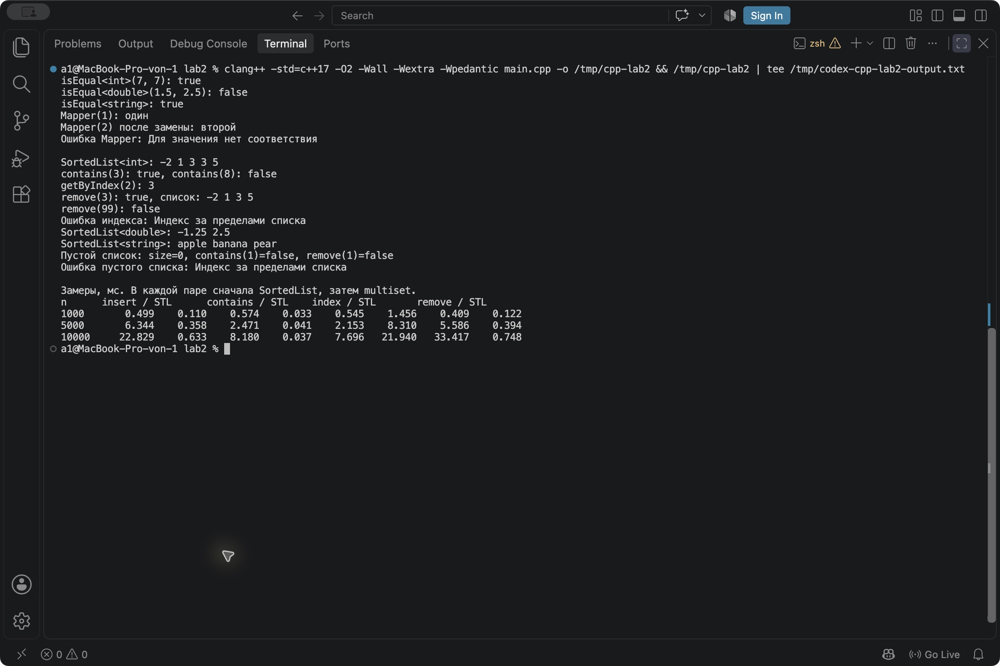
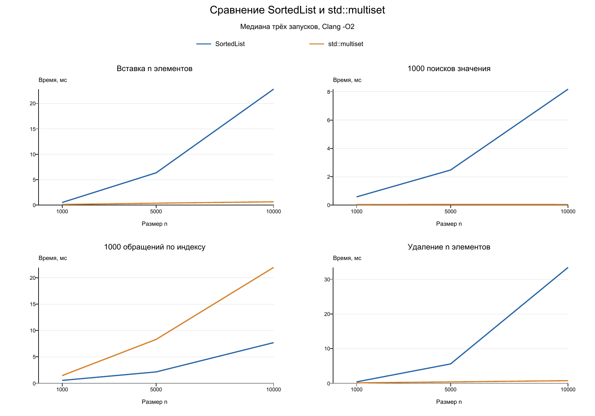

# Лабораторная работа № 2

Анализ сложности алгоритмов. Шаблоны классов.

Дисциплина - Алгоритмы и структуры данных  
Студент - Осипов Герман Юрьевич  
Группа - ПИЖ-б-о-25-2  
Вариант - 10  
Уровень - продвинутый  
Год - 2026

## Содержание

- [Цель работы](#цель-работы)
- [Теория и анализ фрагментов](#теория-и-анализ-фрагментов)
- [Постановка задачи](#постановка-задачи)
- [Реализация](#реализация)
- [Анализ сложности операций](#анализ-сложности-операций)
- [Сборка и запуск](#сборка-и-запуск)
- [Листинг программы](#листинг-программы)
- [Результаты и сравнение со STL](#результаты-и-сравнение-со-stl)
- [Контрольные вопросы](#контрольные-вопросы)
- [Вывод](#вывод)
- [Репозиторий](#репозиторий)

## Цель работы

Научиться оценивать сложность операций, создавать шаблоны функций и классов и сравнивать собственный контейнер с контейнером стандартной библиотеки.

## Теория и анализ фрагментов

О-нотация описывает верхнюю асимптотическую границу роста затрат при увеличении размера входных данных. При оценке отбрасываются постоянные множители и слагаемые меньшего порядка.

Временная сложность описывает рост числа операций, пространственная - объём используемой памяти. Измеренное время дополнительно зависит от компилятора, данных, выделения памяти и работы кеша процессора.

| Сложность | Пример |
| --- | --- |
| O(1) | Доступ по индексу к массиву |
| O(log n) | Бинарный поиск в отсортированном массиве |
| O(n) | Линейный проход по списку |
| O(n log n) | Сортировка слиянием |
| O(n²) | Два полных вложенных цикла |
| O(2ⁿ) | Верхняя оценка наивного рекурсивного вычисления Фибоначчи |

В практическом примере методички разобраны фрагменты A-E.

| Фрагмент | Оценка | Обоснование |
| --- | --- | --- |
| A, сумма массива | O(n) | Один проход из n итераций |
| B, сравнение всех пар | O(n²) | Для каждого элемента выполняется ещё n сравнений |
| C, удвоение i | O(log n) | После k шагов i равно 2 в степени k |
| D, внешний проход и деление j пополам | O(n log n) | Логарифмический цикл повторяется n раз |
| E, условие i * i < n | O(√n) | i увеличивается приблизительно до √n |

Эти оценки относятся к математическому числу итераций. Для очень больших значений исходные примеры C и E требуют защиты от переполнения целого типа.

Шаблон функции задаёт общий алгоритм для нескольких типов. Шаблон класса позволяет создавать контейнеры и другие структуры с выбранным типом данных.

## Постановка задачи

Для варианта 10 продвинутого уровня требуется SortedList<T> с операциями insert, contains, remove и getByIndex. Список должен сохранять порядок. Нужно проанализировать операции и экспериментально сравнить их с аналогом из STL.

В критериях включены требования предыдущих уровней. Поэтому в main.cpp также реализованы функция isEqual(T a, T b) базового уровня и класс Mapper<Tin, Tout> среднего уровня.

## Реализация

SortedList реализован как односвязный список. Каждый узел хранит значение и адрес следующего узла. При вставке находится первое значение, которое не меньше нового, затем перед ним добавляется узел.

Повторы допускаются. remove(value) удаляет одно вхождение и возвращает true. Если значения нет, возвращается false. contains() прекращает проход, когда искомое значение уже не может встретиться дальше.

getByIndex() использует индексы с нуля и возвращает константную ссылку. Это позволяет прочитать элемент, сохранив порядок списка. Выход за границы вызывает out_of_range. Узлы удаляются итеративно. Копирование контейнера запрещено, чтобы два списка случайно не владели одними узлами.

Тип T должен поддерживать согласованные операции < и ==. При использовании print() также требуется вывод в поток. Для вещественных значений предполагаются обычные упорядочиваемые числа.

Для сравнения выбран std::multiset<int>, поскольку он хранит отсортированные значения и допускает повторы. Для удаления в STL сначала вызывается find(), затем erase(iterator), чтобы удалить одно вхождение. Для доступа по индексу итератор multiset продвигается от begin() через std::advance().

Mapper хранит пары входного и выходного значений. addMapping() добавляет соответствие или заменяет результат существующего ключа. apply() возвращает результат либо вызывает исключение, если соответствия нет. В демонстрации используются ключи int и результаты string.

## Анализ сложности операций

Оценки ниже предполагают постоянную стоимость сравнения, копирования и уничтожения одного значения T. Для строк дополнительно учитывается их длина.

| Операция SortedList | Лучший случай | Худший случай | Причина |
| --- | --- | --- | --- |
| Конструктор | O(1) | O(1) | Пустой указатель и нулевой счётчик |
| insert | O(1) | O(n) | Вставка в начало либо поиск места через весь список |
| contains | O(1) | O(n) | Сравнение головы либо проход по списку |
| remove | O(1) | O(n) | Удаление головы либо поиск узла |
| getByIndex | O(1) | O(n) | Индекс 0 либо переход к последнему узлу |
| size | O(1) | O(1) | Возврат готового счётчика |
| print | O(n) | O(n) | Последовательный вывод всех узлов |
| Деструктор | O(n) | O(n) | Удаление каждого узла |

Список занимает O(n) памяти. Дополнительная память операций составляет O(1), если считать размер T постоянным.

| Другая операция | Сложность |
| --- | --- |
| isEqual для int и double | O(1) |
| isEqual для строк длины до L | O(L), включая копирование аргументов |
| Конструктор Mapper | O(1) |
| Mapper::addMapping | O(m), где m - число соответствий |
| Mapper::apply | O(m), плюс стоимость копирования результата |

Mapper занимает O(m) памяти. Удаление его вектора занимает O(m), если уничтожение одной пары имеет постоянную стоимость.

| Операция | SortedList | std::multiset |
| --- | --- | --- |
| Вставка одного элемента | O(n) | O(log n) |
| Поиск значения | O(n) | O(log n) |
| Удаление одного значения с поиском | O(n) | O(log n) |
| Доступ к индексу через проход | O(n) | O(n) |

## Сборка и запуск

Из папки lab2 выполнить команды.

```bash
clang++ -std=c++17 -O2 -Wall -Wextra -Wpedantic main.cpp -o lab2
./lab2
```

Можно использовать g++ с теми же параметрами. Для Windows запуск выполняется через lab2.exe.

Измерения проведены на macOS ARM64 с Apple Clang 17.0.0. Компиляция с указанными предупреждениями прошла успешно. Дополнительно корректность проверена сравнением случайных операций со std::multiset и запуском с AddressSanitizer и UndefinedBehaviorSanitizer.

## Листинг программы

Исходный файл - [main.cpp](main.cpp).

```cpp
#include <algorithm>
#include <array>
#include <chrono>
#include <cstdint>
#include <iomanip>
#include <iostream>
#include <iterator>
#include <random>
#include <set>
#include <stdexcept>
#include <string>
#include <utility>
#include <vector>

template <typename T>
bool isEqual(T a, T b) {
    return a == b;
}

template <typename Tin, typename Tout>
class Mapper {
private:
    std::vector<std::pair<Tin, Tout>> mappings;

public:
    Mapper() = default;

    // Поиск существующего ключа занимает O(m).
    void addMapping(const Tin& input, const Tout& output) {
        for (auto& mapping : mappings) {
            if (mapping.first == input) {
                mapping.second = output;
                return;
            }
        }
        mappings.emplace_back(input, output);
    }

    Tout apply(const Tin& input) const {
        for (const auto& mapping : mappings) {
            if (mapping.first == input) {
                return mapping.second;
            }
        }
        throw std::out_of_range("Для значения нет соответствия");
    }
};

template <typename T>
class SortedList {
private:
    struct Node {
        T value;
        Node* next;

        Node(const T& item, Node* following) : value(item), next(following) {}
    };

    Node* head = nullptr;
    std::size_t count = 0;

public:
    SortedList() = default;
    SortedList(const SortedList&) = delete;
    SortedList& operator=(const SortedList&) = delete;

    ~SortedList() {
        // Итеративное освобождение не увеличивает глубину стека.
        while (head != nullptr) {
            Node* removed = head;
            head = head->next;
            delete removed;
        }
    }

    // O(n): найти место и вставить один узел.
    void insert(const T& value) {
        Node* previous = nullptr;
        Node* current = head;
        while (current != nullptr && current->value < value) {
            previous = current;
            current = current->next;
        }

        Node* added = new Node(value, current);
        if (previous == nullptr) {
            head = added;
        } else {
            previous->next = added;
        }
        ++count;
    }

    // O(n): проход останавливается, когда искомое значение уже пропущено.
    bool contains(const T& value) const {
        Node* current = head;
        while (current != nullptr && current->value < value) {
            current = current->next;
        }
        return current != nullptr && current->value == value;
    }

    // Удаляется одно вхождение. Поиск - O(n), отсоединение узла - O(1).
    bool remove(const T& value) {
        Node* previous = nullptr;
        Node* current = head;
        while (current != nullptr && current->value < value) {
            previous = current;
            current = current->next;
        }
        if (current == nullptr || !(current->value == value)) {
            return false;
        }
        if (previous == nullptr) {
            head = current->next;
        } else {
            previous->next = current->next;
        }
        delete current;
        --count;
        return true;
    }

    const T& getByIndex(std::size_t index) const {
        if (index >= count) {
            throw std::out_of_range("Индекс за пределами списка");
        }
        Node* current = head;
        for (std::size_t i = 0; i < index; ++i) {
            current = current->next;
        }
        return current->value;
    }

    std::size_t size() const {
        return count;
    }

    void print() const {
        for (Node* current = head; current != nullptr; current = current->next) {
            std::cout << current->value << ' ';
        }
        std::cout << '\n';
    }
};

// Один наблюдаемый результат на серию не даёт удалить вычисления при оптимизации.
volatile std::uint64_t benchmarkResult = 0;

template <typename Action>
double measureTime(Action action) {
    const auto start = std::chrono::steady_clock::now();
    benchmarkResult = action();
    const auto finish = std::chrono::steady_clock::now();
    return std::chrono::duration<double, std::milli>(finish - start).count();
}

std::array<double, 8> runBenchmark(const std::vector<int>& values,
                                   const std::vector<int>& queries,
                                   const std::vector<std::size_t>& indexes) {
    SortedList<int> own;
    std::multiset<int> standard;
    std::array<double, 8> times{};

    times[0] = measureTime([&] {
        for (int value : values) {
            own.insert(value);
        }
        return own.size();
    });
    times[1] = measureTime([&] {
        for (int value : values) {
            standard.insert(value);
        }
        return standard.size();
    });
    times[2] = measureTime([&] {
        std::uint64_t found = 0;
        for (int value : queries) {
            found += own.contains(value);
        }
        return found;
    });
    times[3] = measureTime([&] {
        std::uint64_t found = 0;
        for (int value : queries) {
            found += standard.find(value) != standard.end();
        }
        return found;
    });
    times[4] = measureTime([&] {
        std::uint64_t sum = 0;
        for (std::size_t index : indexes) {
            sum += own.getByIndex(index);
        }
        return sum;
    });
    times[5] = measureTime([&] {
        std::uint64_t sum = 0;
        for (std::size_t index : indexes) {
            auto position = standard.begin();
            std::advance(position, static_cast<std::ptrdiff_t>(index));
            sum += *position;
        }
        return sum;
    });
    times[6] = measureTime([&] {
        std::uint64_t removed = 0;
        for (int value : values) {
            removed += own.remove(value);
        }
        return removed;
    });
    times[7] = measureTime([&] {
        std::uint64_t removed = 0;
        for (int value : values) {
            auto position = standard.find(value);
            if (position != standard.end()) {
                standard.erase(position); // Как и remove(), удаляем одно вхождение.
                ++removed;
            }
        }
        return removed;
    });
    return times;
}

void demonstrateTemplates() {
    std::cout << std::boolalpha;
    std::cout << "isEqual<int>(7, 7): " << isEqual(7, 7) << '\n';
    std::cout << "isEqual<double>(1.5, 2.5): " << isEqual(1.5, 2.5) << '\n';
    std::cout << "isEqual<string>: "
              << isEqual(std::string("cat"), std::string("cat")) << '\n';

    Mapper<int, std::string> mapper;
    mapper.addMapping(1, "один");
    mapper.addMapping(2, "два");
    mapper.addMapping(2, "второй");
    std::cout << "Mapper(1): " << mapper.apply(1) << '\n';
    std::cout << "Mapper(2) после замены: " << mapper.apply(2) << '\n';
    try {
        mapper.apply(3);
    } catch (const std::out_of_range& error) {
        std::cout << "Ошибка Mapper: " << error.what() << '\n';
    }

    SortedList<int> numbers;
    for (int value : {5, 1, 3, 3, -2}) {
        numbers.insert(value);
    }
    std::cout << "\nSortedList<int>: ";
    numbers.print();
    std::cout << "contains(3): " << numbers.contains(3)
              << ", contains(8): " << numbers.contains(8) << '\n';
    std::cout << "getByIndex(2): " << numbers.getByIndex(2) << '\n';
    std::cout << "remove(3): " << numbers.remove(3) << ", список: ";
    numbers.print();
    std::cout << "remove(99): " << numbers.remove(99) << '\n';
    try {
        numbers.getByIndex(numbers.size());
    } catch (const std::out_of_range& error) {
        std::cout << "Ошибка индекса: " << error.what() << '\n';
    }

    SortedList<double> fractions;
    fractions.insert(2.5);
    fractions.insert(-1.25);
    std::cout << "SortedList<double>: ";
    fractions.print();

    SortedList<std::string> words;
    words.insert("pear");
    words.insert("apple");
    words.insert("banana");
    std::cout << "SortedList<string>: ";
    words.print();

    SortedList<int> empty;
    std::cout << "Пустой список: size=" << empty.size()
              << ", contains(1)=" << empty.contains(1)
              << ", remove(1)=" << empty.remove(1) << '\n';
    try {
        empty.getByIndex(0);
    } catch (const std::out_of_range& error) {
        std::cout << "Ошибка пустого списка: " << error.what() << '\n';
    }
}

int main() {
    demonstrateTemplates();
    std::cout << "\nЗамеры, мс. В каждой паре сначала SortedList, затем multiset.\n";
    std::cout << "n      insert / STL      contains / STL    index / STL       remove / STL\n";
    std::cout << std::fixed << std::setprecision(3);

    for (int n : {1000, 5000, 10000}) {
        std::mt19937 generator(42);
        std::uniform_int_distribution<int> distribution(0, n);
        std::uniform_int_distribution<std::size_t> indexDistribution(0, n - 1);
        std::vector<int> values(n);
        std::vector<int> queries(1000);
        std::vector<std::size_t> indexes(1000);
        for (int& value : values) {
            value = distribution(generator);
        }
        for (int& query : queries) {
            query = distribution(generator);
        }
        for (auto& index : indexes) {
            index = indexDistribution(generator);
        }

        std::array<std::array<double, 8>, 3> runs;
        for (auto& run : runs) {
            run = runBenchmark(values, queries, indexes);
        }
        std::cout << std::left << std::setw(7) << n;
        for (std::size_t operation = 0; operation < 8; ++operation) {
            std::array<double, 3> samples{
                runs[0][operation], runs[1][operation], runs[2][operation]
            };
            std::sort(samples.begin(), samples.end());
            std::cout << std::right << std::setw(9) << samples[1];
        }
        std::cout << '\n';
    }
    return 0;
}
```

## Результаты и сравнение со STL

Продемонстрированы три типа SortedList - int, double и string. Проверены повторы, удаление отсутствующего значения, пустой контейнер и неверный индекс. Для Mapper показаны добавление, замена соответствия и ошибка неизвестного ключа.

Фактический вывод итогового запуска.

```text
isEqual<int>(7, 7): true
isEqual<double>(1.5, 2.5): false
isEqual<string>: true
Mapper(1): один
Mapper(2) после замены: второй
Ошибка Mapper: Для значения нет соответствия

SortedList<int>: -2 1 3 3 5 
contains(3): true, contains(8): false
getByIndex(2): 3
remove(3): true, список: -2 1 3 5 
remove(99): false
Ошибка индекса: Индекс за пределами списка
SortedList<double>: -1.25 2.5 
SortedList<string>: apple banana pear 
Пустой список: size=0, contains(1)=false, remove(1)=false
Ошибка пустого списка: Индекс за пределами списка

Замеры, мс. В каждой паре сначала SortedList, затем multiset.
n      insert / STL      contains / STL    index / STL       remove / STL
1000       0.499    0.110    0.574    0.033    0.545    1.456    0.409    0.122
5000       6.344    0.358    2.471    0.041    2.153    8.310    5.586    0.394
10000     22.829    0.633    8.180    0.037    7.696   21.940   33.417    0.748
```



Рисунок 1 - Компиляция, демонстрация шаблонов и результаты измерений в VS Code.

### Методика измерений

Для каждого n созданы одинаковые исходные значения для обоих контейнеров. Использован генератор mt19937 с seed 42 и числа от 0 до n, поэтому в данных возможны повторы. Подготовка значений, запросов и индексов выполняется до начала измерений.

Для каждого размера проведены три запуска. В таблицу попала медиана времени каждой операции. Время измеряется через steady_clock в миллисекундах.

- Вставка добавляет n значений в пустой контейнер.
- contains выполняет 1000 поисков одинаковых значений.
- Доступ по индексу выполняется 1000 раз с одинаковыми случайными индексами.
- Удаление обрабатывает все n исходных значений, удаляя по одному вхождению.

Время каждой серии включает её цикл и операции контейнера. Число найденных, прочитанных или удалённых элементов записывается в volatile-переменную, чтобы результат вычислений использовался при оптимизации. Вывод на экран выполняется после измерений.

### Таблица измерений

Все значения приведены в миллисекундах. Это время серии операций.

| n | insert, свой | insert, STL | contains, свой | contains, STL | индекс, свой | индекс, STL | remove, свой | remove, STL |
| --- | --- | --- | --- | --- | --- | --- | --- | --- |
| 1000 | 0.499 | 0.110 | 0.574 | 0.033 | 0.545 | 1.456 | 0.409 | 0.122 |
| 5000 | 6.344 | 0.358 | 2.471 | 0.041 | 2.153 | 8.310 | 5.586 | 0.394 |
| 10000 | 22.829 | 0.633 | 8.180 | 0.037 | 7.696 | 21.940 | 33.417 | 0.748 |



Рисунок 2 - Сравнение времени операций по фактическим измерениям.

Для n вставок в собственный список худшая оценка всей серии составляет O(n²), для multiset - O(n log n). При q поисках оценки равны O(qn) и O(q log n). Для q обращений по индексу оба выбранных способа имеют O(qn). Серия удаления n значений имеет оценки O(n²) и O(n log n).

В полученном запуске multiset быстрее выполнял вставку, поиск и удаление. Доступ по индексу оказался быстрее у односвязного списка. Для этой операции оба контейнера требуют прохода, а фактическое время зависит от структуры узлов и работы памяти. Повторный запуск может дать другие числа.

## Контрольные вопросы

### 1. Что такое О-нотация и зачем она нужна

О-нотация задаёт верхнюю границу роста затрат алгоритма при увеличении входных данных. Она позволяет сравнивать алгоритмы по характеру роста, не привязываясь к конкретной модели компьютера. Например, полный проход по n элементам имеет оценку O(n).

### 2. Какая сложность у доступа к массиву по индексу и почему

O(1). Элементы массива расположены подряд, адрес нужного вычисляется по адресу начала, индексу и размеру элемента. Проходить предыдущие элементы не требуется. У связного списка доступ устроен через последовательные переходы и может занимать O(n).

### 3. Какая сложность у бинарного поиска и почему

O(log n), потому что на каждом шаге область поиска сокращается примерно вдвое. После k шагов остаётся около n / 2 в степени k элементов. Для обычного бинарного поиска нужен отсортированный массив с быстрым доступом по индексу.

### 4. Что означает O(n log n)

Затраты растут как произведение n и логарифма n. Пример - сортировка слиянием. На каждом уровне обрабатываются все элементы, а число уровней пропорционально log n.

### 5. Что такое амортизированный анализ

Он оценивает затраты на последовательность операций. Например, динамический массив иногда расширяется с копированием O(n) элементов. Если ёмкость каждый раз удваивается, суммарные затраты n добавлений составляют O(n), то есть одно добавление амортизированно O(1).

### 6. Какая сложность у двух вложенных циклов по n итераций

O(n²), если внутренний цикл полностью выполняется для каждой итерации внешнего и тело имеет постоянную стоимость. В сумме выполняется n * n итераций. Наличие двух циклов само по себе ещё требует проверки их границ.

### 7. Какая сложность у рекурсивного вычисления Фибоначчи

У наивной рекурсии без запоминания результатов сложность экспоненциальная, верхняя оценка O(2ⁿ). Причина - повторное вычисление одних и тех же чисел в разных ветвях. Итеративный алгоритм вычисляет значение за O(n) времени и O(1) дополнительной памяти.

### 8. Что такое шаблон функции и как его использовать

Шаблон описывает функцию с параметром типа. Компилятор создаёт подходящий вариант при использовании.

```cpp
template <typename T>
bool isEqual(T a, T b) {
    return a == b;
}

// isEqual(3, 3);
// isEqual(std::string("a"), std::string("b"));
```

### 9. Что такое шаблон класса и как его использовать

Шаблон задаёт общую структуру класса для разных типов. Например, SortedList<int> хранит целые числа, а SortedList<string> - строки. Методы определены один раз и компилируются для используемого типа.

### 10. В чём преимущество шаблонов перед перегрузкой

Шаблон позволяет описать одинаковый алгоритм один раз. При перегрузке для int, double и string пришлось бы писать отдельные функции. Перегрузка удобна, если поведение для разных типов должно различаться.

### 11. Как указать, что параметр шаблона является типом

Используется typename или class, например template <typename T>. В объявлении параметра типа эти варианты равнозначны. Требования к операциям над T определяются тем, что используется внутри шаблона.

### 12. Можно ли использовать несколько параметров типов

Да. В работе Mapper<Tin, Tout> получает тип входного и выходного значения отдельно. Например, Mapper<int, string> связывает числовой ключ со строкой.

### 13. Как экспериментально измерить время выполнения

Нужно подготовить данные, зафиксировать время до операции и после неё и вычислить разницу. В программе использован steady_clock. Для сравнения одинаковые запросы выполняются над обоими контейнерами с одинаковыми параметрами сборки.

### 14. Зачем выполнять операцию многократно

Одна быстрая операция может занимать меньше разрешения таймера, а системная нагрузка добавляет шум. Серия операций даёт более заметное время. Повторение всей серии и выбор медианы уменьшают влияние отдельных выбросов.

### 15. Что важнее - сложность или константа

На больших объёмах данных разница в характере роста обычно важнее постоянного множителя. На небольших объёмах быстрее может оказаться реализация с худшей асимптотикой, но меньшими накладными расходами. Поэтому полезно учитывать оценку сложности и реальные измерения для нужных данных.

## Вывод

Реализованы шаблонная функция, класс соответствий и отсортированный связный список. Для операций определена сложность. Проведено сравнение со std::multiset на одинаковых данных, построены таблица и график измерений. На практике различаются как оценки алгоритмов, так и накладные расходы структур данных.

## Репозиторий

[Исходник и отчёт лабораторной работы](https://github.com/foidslayer33367/cpp-labs/tree/main/lab2)
