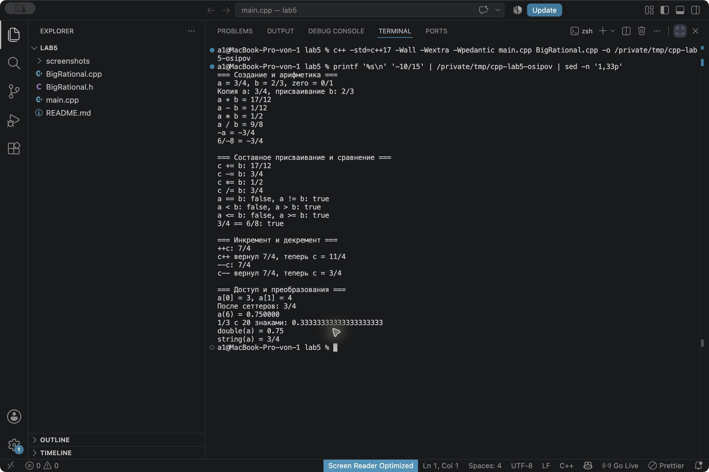
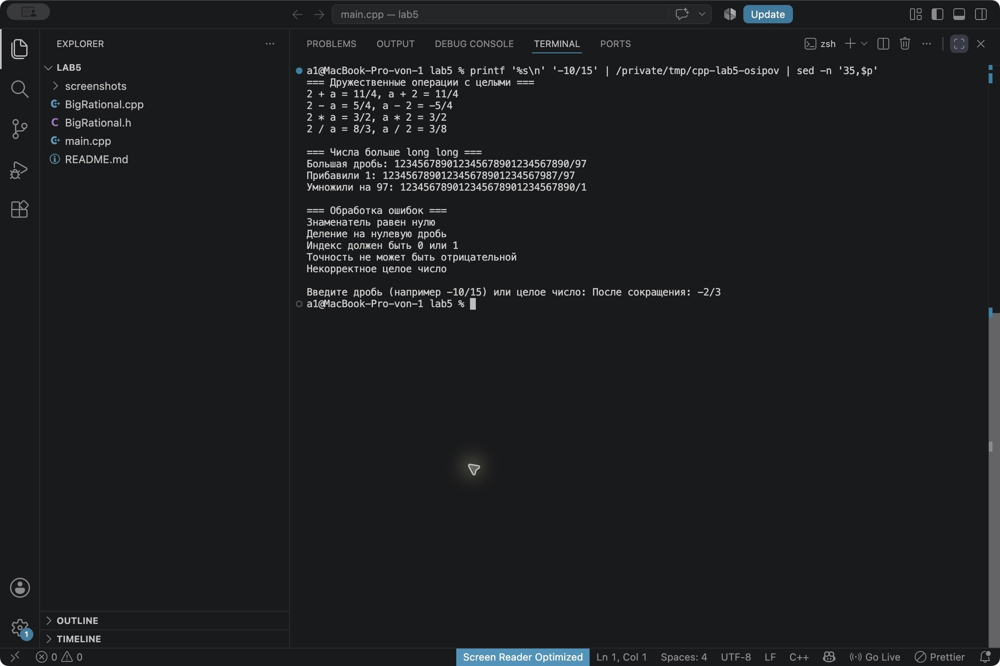

# Лабораторная работа № 5

## Титульный лист

**Дисциплина:** Алгоритмы и структуры данных  
**Тема:** Перегрузка операторов. Дружественные функции  
**Вариант:** 10  
**Уровень:** повышенный  
**Студент:** Осипов Герман Юрьевич  
**Группа:** ПИЖ-б-о-25-2  
**Язык:** C++17  
**Год:** 2026

## 1. Цель работы

Научиться перегружать операторы C++ и применять дружественные функции. Разработать класс дробей произвольной точности и проверить арифметику, сравнение, ввод и вывод, преобразование типов и обработку ошибок.

## 2. Теоретическая часть

### Перегрузка операторов

Перегрузка задает поведение стандартного оператора для объектов своего класса. Например, запись `a + b` может складывать две дроби. При этом нельзя менять приоритет, ассоциативность и количество операндов. Для обычных арифметических операторов хотя бы один операнд должен иметь пользовательский тип.

Объявление метода имеет вид `BigRational& operator+=(const BigRational& other);`. Левый операнд передается через `this`, а правый через аргумент. Такой метод изменяет текущий объект и возвращает ссылку на него, поэтому можно выполнять цепочки присваиваний.

Дружественная функция объявляется с ключевым словом `friend`. Она не является методом, но получает доступ к закрытым полям класса. Например: `friend BigRational operator+(const BigRational& a, const BigRational& b);`.

### Выбор способа перегрузки

Изменяющие операции `=`, `+=`, `-=`, `*=`, `/=`, `++` и `--` удобно оформлять методами. Для арифметики в этой работе выбраны дружественные функции: оба операнда обрабатываются одинаково, допускается преобразование целого числа в дробь с любой стороны. Благодаря конструктору от `long long` работают и `2 + a`, и `a + 2`.

Потоковые операторы `<<` и `>>` оформлены свободными дружественными функциями. В выражении `std::cout << a` левый операнд является потоком, поэтому сделать эту операцию методом `BigRational` нельзя. Дружба нужна для прямого доступа к полям; при использовании геттеров свободная функция могла бы обойтись без `friend`.

### Хранение больших чисел

Числитель `num` и знаменатель `den` хранятся в `std::string` как последовательности десятичных цифр. Строка служит динамическим массивом символов, поэтому число не ограничено диапазоном `int` или `long long`. Практический предел задается доступной памятью и временем вычисления. Знак хранится в начале строки числителя; знаменатель после нормализации всегда положительный.

Сложение и вычитание выполняются по разрядам с переносом и займом, умножение и деление выполняются столбиком. Для сокращения используется алгоритм Евклида: вычисляется НОД числителя и знаменателя, затем оба числа делятся на него. Нулевая дробь приводится к `0/1`.

Класс содержит конструктор копирования, оператор присваивания и деструктор. Для них достаточно `= default`: памятью строк управляет стандартная библиотека, вручную удалять массивы не требуется.

## 3. Постановка задачи

Вариант 10 повышенного уровня: разработать класс `BigRational` с полями `num[]`, `den[]` для дробей произвольной точности. В программе массивы десятичных цифр представлены строками `num` и `den`.

Требуется реализовать:

- Конструкторы по умолчанию, с параметрами и копирования, деструктор, геттеры и сеттеры.
- Потоковый ввод и вывод, арифметические операции `+`, `-`, `*`, `/` и сравнения `==`, `!=`.
- Составное присваивание `+=`, `-=`, `*=`, `/=` и сравнения `<`, `>`, `<=`, `>=`.
- Префиксный и постфиксный инкремент и декремент.
- Операторы `[]`, `()`, явные преобразования типов.
- Дружественные функции для операций с дробями и целыми числами.
- Исключения при ошибках.

В этой реализации `r[0]` возвращает числитель, `r[1]` знаменатель. Доступ только для чтения, чтобы через индекс нельзя было записать нулевой знаменатель или нарушить сокращенную форму. Для изменения предусмотрены сеттеры с проверкой. `r(n)` возвращает десятичную строку с `n` знаками после точки без округления.

## 4. Листинг программы

Код разделен на три файла согласно методическим указаниям.

### 4.1. Объявление класса

`BigRational.h`

```cpp
#ifndef BIG_RATIONAL_H
#define BIG_RATIONAL_H

#include <iostream>
#include <string>

class BigRational {
private:
    // Строки хранят массивы десятичных цифр без ограничения размером int.
    std::string num;
    std::string den;
    void normalize();

public:
    BigRational();
    BigRational(long long value);
    BigRational(const std::string& numerator, const std::string& denominator);
    BigRational(const BigRational& other);
    ~BigRational();
    BigRational& operator=(const BigRational& other);

    const std::string& getNumerator() const;
    const std::string& getDenominator() const;
    void setNumerator(const std::string& value);
    void setDenominator(const std::string& value);

    friend BigRational operator+(const BigRational& a, const BigRational& b);
    friend BigRational operator-(const BigRational& a, const BigRational& b);
    friend BigRational operator*(const BigRational& a, const BigRational& b);
    friend BigRational operator/(const BigRational& a, const BigRational& b);
    BigRational operator-() const;
    BigRational& operator+=(const BigRational& other);
    BigRational& operator-=(const BigRational& other);
    BigRational& operator*=(const BigRational& other);
    BigRational& operator/=(const BigRational& other);

    bool operator==(const BigRational& other) const;
    bool operator!=(const BigRational& other) const;
    bool operator<(const BigRational& other) const;
    bool operator>(const BigRational& other) const;
    bool operator<=(const BigRational& other) const;
    bool operator>=(const BigRational& other) const;

    BigRational& operator++();
    BigRational operator++(int);
    BigRational& operator--();
    BigRational operator--(int);

    // 0 - числитель, 1 - знаменатель. Изменение выполняется сеттерами.
    const std::string& operator[](int index) const;
    std::string operator()(int precision) const;
    explicit operator double() const;
    explicit operator std::string() const;

    friend std::ostream& operator<<(std::ostream& out, const BigRational& value);
    friend std::istream& operator>>(std::istream& in, BigRational& value);
};

#endif
```

### 4.2. Реализация методов и дружественных функций

`BigRational.cpp`

```cpp
#include "BigRational.h"
#include <algorithm>
#include <stdexcept>
#include <utility>

namespace {
// Арифметика целых чисел выполняется по цифрам, как на бумаге.
std::string magnitude(const std::string& s) {
    return s[0] == '-' ? s.substr(1) : s;
}

std::string integer(const std::string& s) {
    if (s.empty()) throw std::invalid_argument("Пустое число");
    std::size_t start = (s[0] == '-' || s[0] == '+') ? 1 : 0;
    if (start == s.size()) throw std::invalid_argument("Нет цифр");
    for (std::size_t i = start; i < s.size(); ++i)
        if (s[i] < '0' || s[i] > '9')
            throw std::invalid_argument("Некорректное целое число");
    std::size_t first = s.find_first_not_of('0', start);
    if (first == std::string::npos) return "0";
    return (s[0] == '-' ? "-" : "") + s.substr(first);
}

int compare(const std::string& a, const std::string& b) {
    if (a.size() != b.size()) return a.size() < b.size() ? -1 : 1;
    return a == b ? 0 : (a < b ? -1 : 1);
}

std::string add(const std::string& a, const std::string& b) {
    std::string result;
    int carry = 0;
    std::size_t i = a.size(), j = b.size();
    while (i || j || carry) {
        int sum = carry;
        if (i) sum += a[--i] - '0';
        if (j) sum += b[--j] - '0';
        result.push_back(char('0' + sum % 10));
        carry = sum / 10;
    }
    std::reverse(result.begin(), result.end());
    return result;
}

// Вычитание модулей, a >= b.
std::string subtract(const std::string& a, const std::string& b) {
    std::string result;
    int borrow = 0;
    std::size_t i = a.size(), j = b.size();
    while (i) {
        int digit = a[--i] - '0' - borrow;
        if (j) digit -= b[--j] - '0';
        borrow = digit < 0;
        if (borrow) digit += 10;
        result.push_back(char('0' + digit));
    }
    std::reverse(result.begin(), result.end());
    return integer(result);
}

std::string multiply(const std::string& a, const std::string& b) {
    if (a == "0" || b == "0") return "0";
    std::string result(a.size() + b.size(), '0');
    for (std::size_t i = a.size(); i-- > 0;) {
        int carry = 0;
        for (std::size_t j = b.size(); j-- > 0;) {
            int value = (a[i] - '0') * (b[j] - '0')
                      + (result[i + j + 1] - '0') + carry;
            result[i + j + 1] = char('0' + value % 10);
            carry = value / 10;
        }
        result[i] = char('0' + carry);
    }
    return integer(result);
}

// Деление столбиком возвращает частное и остаток.
std::pair<std::string, std::string> divide(const std::string& a,
                                           const std::string& b) {
    if (b == "0") throw std::domain_error("Деление на ноль");
    std::string quotient, remainder = "0";
    for (char digit : a) {
        remainder = integer(remainder + digit);
        int q = 0;
        while (compare(remainder, b) >= 0) {
            remainder = subtract(remainder, b);
            ++q;
        }
        quotient.push_back(char('0' + q));
    }
    return {integer(quotient), remainder};
}

std::string gcd(std::string a, std::string b) {
    while (b != "0") {
        std::string remainder = divide(a, b).second;
        a = b;
        b = remainder;
    }
    return a;
}

std::string signedAdd(const std::string& a, const std::string& b) {
    bool negativeA = a[0] == '-', negativeB = b[0] == '-';
    std::string x = magnitude(a), y = magnitude(b);
    if (negativeA == negativeB)
        return integer((negativeA ? "-" : "") + add(x, y));
    if (compare(x, y) >= 0)
        return integer((negativeA ? "-" : "") + subtract(x, y));
    return integer((negativeB ? "-" : "") + subtract(y, x));
}

std::string signedMultiply(const std::string& a, const std::string& b) {
    bool negative = (a[0] == '-') != (b[0] == '-');
    return integer((negative ? "-" : "") + multiply(magnitude(a), magnitude(b)));
}
}

BigRational::BigRational() : num("0"), den("1") {}
BigRational::BigRational(long long value) : num(std::to_string(value)), den("1") {}
BigRational::BigRational(const std::string& numerator, const std::string& denominator)
    : num(integer(numerator)), den(integer(denominator)) { normalize(); }
BigRational::BigRational(const BigRational& other) = default;
BigRational::~BigRational() = default;
BigRational& BigRational::operator=(const BigRational& other) = default;

void BigRational::normalize() {
    if (den == "0") throw std::domain_error("Знаменатель равен нулю");
    bool negative = (num[0] == '-') != (den[0] == '-');
    num = magnitude(num);
    den = magnitude(den);
    std::string divisor = gcd(num, den);
    num = divide(num, divisor).first;
    den = divide(den, divisor).first;
    if (negative && num != "0") num = "-" + num;
}

const std::string& BigRational::getNumerator() const { return num; }
const std::string& BigRational::getDenominator() const { return den; }
void BigRational::setNumerator(const std::string& value) {
    *this = BigRational(value, den);
}
void BigRational::setDenominator(const std::string& value) {
    *this = BigRational(num, value);
}

BigRational operator+(const BigRational& a, const BigRational& b) {
    return BigRational(signedAdd(signedMultiply(a.num, b.den),
                                 signedMultiply(b.num, a.den)), multiply(a.den, b.den));
}
BigRational operator-(const BigRational& a, const BigRational& b) { return a + (-b); }
BigRational operator*(const BigRational& a, const BigRational& b) {
    return BigRational(signedMultiply(a.num, b.num), multiply(a.den, b.den));
}
BigRational operator/(const BigRational& a, const BigRational& b) {
    if (b.num == "0") throw std::domain_error("Деление на нулевую дробь");
    return BigRational(signedMultiply(a.num, b.den), signedMultiply(a.den, b.num));
}
BigRational BigRational::operator-() const { return BigRational(signedMultiply(num, "-1"), den); }
BigRational& BigRational::operator+=(const BigRational& b) { return *this = *this + b; }
BigRational& BigRational::operator-=(const BigRational& b) { return *this = *this - b; }
BigRational& BigRational::operator*=(const BigRational& b) { return *this = *this * b; }
BigRational& BigRational::operator/=(const BigRational& b) { return *this = *this / b; }

bool BigRational::operator==(const BigRational& b) const { return num == b.num && den == b.den; }
bool BigRational::operator!=(const BigRational& b) const { return !(*this == b); }
bool BigRational::operator<(const BigRational& b) const {
    return (*this - b).num[0] == '-';
}
bool BigRational::operator>(const BigRational& b) const { return b < *this; }
bool BigRational::operator<=(const BigRational& b) const { return !(*this > b); }
bool BigRational::operator>=(const BigRational& b) const { return !(*this < b); }

BigRational& BigRational::operator++() { return *this += 1; }
BigRational BigRational::operator++(int) { BigRational old(*this); ++*this; return old; }
BigRational& BigRational::operator--() { return *this -= 1; }
BigRational BigRational::operator--(int) { BigRational old(*this); --*this; return old; }

const std::string& BigRational::operator[](int index) const {
    if (index == 0) return num;
    if (index == 1) return den;
    throw std::out_of_range("Индекс должен быть 0 или 1");
}

// Десятичная запись с заданным числом знаков после точки, без округления.
std::string BigRational::operator()(int precision) const {
    if (precision < 0) throw std::invalid_argument("Точность не может быть отрицательной");
    auto parts = divide(magnitude(num), den);
    std::string result = (num[0] == '-' ? "-" : "") + parts.first;
    if (precision > 0) result += '.';
    for (int i = 0; i < precision; ++i) {
        parts = divide(parts.second + "0", den);
        result += parts.first;
    }
    return result;
}

BigRational::operator double() const {
    // double приблизителен и ограничен по диапазону; stod может бросить out_of_range.
    return std::stod(num) / std::stod(den);
}
BigRational::operator std::string() const { return num + "/" + den; }
std::ostream& operator<<(std::ostream& out, const BigRational& value) {
    return out << value.num << '/' << value.den;
}
std::istream& operator>>(std::istream& in, BigRational& value) {
    std::string text;
    if (!(in >> text)) return in;
    std::size_t slash = text.find('/');
    // Объект меняется только после успешной проверки всей дроби.
    value = slash == std::string::npos ? BigRational(text, "1")
          : BigRational(text.substr(0, slash), text.substr(slash + 1));
    return in;
}
```

### 4.3. Демонстрационная программа

`main.cpp`

```cpp
#include "BigRational.h"
#include <stdexcept>

int main() {
    std::cout << std::boolalpha;
    BigRational a("3", "4"), b("2", "3"), zero;
    BigRational copy(a), assigned;
    assigned = b;
    std::cout << "=== Создание и арифметика ===\n";
    std::cout << "a = " << a << ", b = " << b << ", zero = " << zero << '\n';
    std::cout << "Копия a: " << copy << ", присваивание b: " << assigned << '\n';
    std::cout << "a + b = " << a + b << '\n';
    std::cout << "a - b = " << a - b << '\n';
    std::cout << "a * b = " << a * b << '\n';
    std::cout << "a / b = " << a / b << '\n';
    std::cout << "-a = " << -a << '\n';
    std::cout << "6/-8 = " << BigRational("6", "-8") << '\n';

    std::cout << "\n=== Составное присваивание и сравнение ===\n";
    BigRational c(a);
    c += b; std::cout << "c += b: " << c << '\n';
    c -= b; std::cout << "c -= b: " << c << '\n';
    c *= b; std::cout << "c *= b: " << c << '\n';
    c /= b; std::cout << "c /= b: " << c << '\n';
    std::cout << "a == b: " << (a == b) << ", a != b: " << (a != b) << '\n';
    std::cout << "a < b: " << (a < b) << ", a > b: " << (a > b) << '\n';
    std::cout << "a <= b: " << (a <= b) << ", a >= b: " << (a >= b) << '\n';
    std::cout << "3/4 == 6/8: " << (a == BigRational("6", "8")) << '\n';

    std::cout << "\n=== Инкремент и декремент ===\n";
    std::cout << "++c: " << ++c << '\n';
    std::cout << "c++ вернул " << c++ << ", теперь c = " << c << '\n';
    std::cout << "--c: " << --c << '\n';
    std::cout << "c-- вернул " << c-- << ", теперь c = " << c << '\n';

    std::cout << "\n=== Доступ и преобразования ===\n";
    std::cout << "a[0] = " << a[0] << ", a[1] = " << a[1] << '\n';
    c.setNumerator("9");
    c.setDenominator("12");
    std::cout << "После сеттеров: " << c.getNumerator() << '/' << c.getDenominator() << '\n';
    std::cout << "a(6) = " << a(6) << '\n';
    std::cout << "1/3 с 20 знаками: " << BigRational("1", "3")(20) << '\n';
    std::cout << "double(a) = " << static_cast<double>(a) << '\n';
    std::cout << "string(a) = " << static_cast<std::string>(a) << '\n';

    std::cout << "\n=== Дружественные операции с целыми ===\n";
    std::cout << "2 + a = " << 2 + a << ", a + 2 = " << a + 2 << '\n';
    std::cout << "2 - a = " << 2 - a << ", a - 2 = " << a - 2 << '\n';
    std::cout << "2 * a = " << 2 * a << ", a * 2 = " << a * 2 << '\n';
    std::cout << "2 / a = " << 2 / a << ", a / 2 = " << a / 2 << '\n';

    std::cout << "\n=== Числа больше long long ===\n";
    BigRational large("123456789012345678901234567890", "97");
    std::cout << "Большая дробь: " << large << '\n';
    std::cout << "Прибавили 1: " << large + 1 << '\n';
    std::cout << "Умножили на 97: " << large * 97 << '\n';

    std::cout << "\n=== Обработка ошибок ===\n";
    try { BigRational bad("1", "0"); }
    catch (const std::exception& e) { std::cout << e.what() << '\n'; }
    try { std::cout << a / zero; }
    catch (const std::exception& e) { std::cout << e.what() << '\n'; }
    try { std::cout << a[2]; }
    catch (const std::exception& e) { std::cout << e.what() << '\n'; }
    try { std::cout << a(-1); }
    catch (const std::exception& e) { std::cout << e.what() << '\n'; }
    try { BigRational bad("12a", "3"); }
    catch (const std::exception& e) { std::cout << e.what() << '\n'; }

    std::cout << "\nВведите дробь (например -10/15) или целое число: ";
    try {
        BigRational input;
        if (std::cin >> input) std::cout << "После сокращения: " << input << '\n';
        else std::cout << "Ввод не получен\n";
    } catch (const std::exception& e) {
        std::cout << "Ошибка ввода: " << e.what() << '\n';
    }
}
```

## 5. Результаты работы

### Сборка и запуск

Открыть терминал в папке `lab5`. Нужен компилятор с поддержкой C++17, дополнительные библиотеки не используются.

Сборка в macOS или Linux:

```bash
c++ -std=c++17 -Wall -Wextra -Wpedantic main.cpp BigRational.cpp -o lab5
./lab5
```

В Windows с установленным MinGW:

```powershell
g++ -std=c++17 -Wall -Wextra -Wpedantic main.cpp BigRational.cpp -o lab5.exe
.\lab5.exe
```

Исходники сохранены в UTF-8. В консоли Windows для русского вывода при необходимости выбрать UTF-8 командой `chcp 65001`.

Программа собрана и запущена на macOS с Clang, предупреждений при сборке нет. Для демонстрации ввода использована дробь `-10/15`.

### Вывод программы

```text
=== Создание и арифметика ===
a = 3/4, b = 2/3, zero = 0/1
Копия a: 3/4, присваивание b: 2/3
a + b = 17/12
a - b = 1/12
a * b = 1/2
a / b = 9/8
-a = -3/4
6/-8 = -3/4

=== Составное присваивание и сравнение ===
c += b: 17/12
c -= b: 3/4
c *= b: 1/2
c /= b: 3/4
a == b: false, a != b: true
a < b: false, a > b: true
a <= b: false, a >= b: true
3/4 == 6/8: true

=== Инкремент и декремент ===
++c: 7/4
c++ вернул 7/4, теперь c = 11/4
--c: 7/4
c-- вернул 7/4, теперь c = 3/4

=== Доступ и преобразования ===
a[0] = 3, a[1] = 4
После сеттеров: 3/4
a(6) = 0.750000
1/3 с 20 знаками: 0.33333333333333333333
double(a) = 0.75
string(a) = 3/4

=== Дружественные операции с целыми ===
2 + a = 11/4, a + 2 = 11/4
2 - a = 5/4, a - 2 = -5/4
2 * a = 3/2, a * 2 = 3/2
2 / a = 8/3, a / 2 = 3/8

=== Числа больше long long ===
Большая дробь: 123456789012345678901234567890/97
Прибавили 1: 123456789012345678901234567987/97
Умножили на 97: 123456789012345678901234567890/1

=== Обработка ошибок ===
Знаменатель равен нулю
Деление на нулевую дробь
Индекс должен быть 0 или 1
Точность не может быть отрицательной
Некорректное целое число

Введите дробь (например -10/15) или целое число: После сокращения: -2/3
```

### Скриншоты запуска





## 6. Анализ результатов

Для `a = 3/4` и `b = 2/3` получены сумма `17/12`, разность `1/12`, произведение `1/2` и частное `9/8`. Результаты автоматически сокращаются. Знак отрицательного знаменателя переносится в числитель: `6/-8` превращается в `-3/4`.

Составные операторы последовательно изменяют дробь и после обратных операций возвращают исходное значение. Сравнение выполняется точно, без преобразования в `double`: например, `3/4` и `6/8` равны после сокращения. Оператор `<` определяет знак разности, остальные сравнения используют уже реализованные операции.

Префиксный `++c` сначала увеличивает дробь на единицу и возвращает новое значение. Постфиксный `c++` возвращает сохраненную копию, затем оставляет в объекте увеличенное значение. Декремент работает аналогично с вычитанием единицы.

Оператор `[]` дает доступ к двум частям дроби. Сеттеры сначала создают проверенный временный объект, поэтому при ошибке исходная дробь не меняется. Конструктор копирования и присваивание копируют строки независимо от исходного объекта.

Вызов `a(6)` дает `0.750000`. Для `1/3` получена строка с 20 тройками после точки. Такая запись строится делением с остатком и не зависит от точности `double`. Явное преобразование в `double` предназначено для приближенного результата. Если отдельные числитель или знаменатель выходят за диапазон `std::stod`, преобразование может вызвать `std::out_of_range`; точная арифметика дробей от этого не ограничивается. Преобразование в строку сохраняет точную запись `числитель/знаменатель`.

Дружественные арифметические функции позволяют смешивать дроби с целыми числами с обеих сторон. Число из 30 цифр в демонстрации выходит за диапазон `long long`, но сложение и умножение выполняются точно, потому что операции работают с массивами цифр.

Ошибки нулевого знаменателя, деления на нулевую дробь, неверного индекса, отрицательной точности и некорректного числа перехватываются через `try/catch`. При вводе `-10/15` программа выводит сокращенную дробь `-2/3`.

## 7. Ответы на контрольные вопросы

**1. Что такое перегрузка операторов и зачем она нужна?**

Это определение поведения стандартных операторов для пользовательских типов. Она позволяет писать `a + b` вместо вызова отдельной функции сложения и делает работу с объектами понятнее.

**2. Какие операторы нельзя перегружать в C++?**

Нельзя перегружать `::`, `.`, `.*`, `?:`, `sizeof`, `typeid`, `alignof` и именованные преобразования `static_cast`, `dynamic_cast`, `const_cast`, `reinterpret_cast`. Приоритет, ассоциативность и количество операндов также не изменяются.

**3. В чем разница между перегрузкой оператора как метода класса и как дружественной функции?**

Метод принадлежит классу и получает левый операнд через `this`. Дружественная функция является свободной, получает операнды как аргументы и имеет доступ к закрытым полям благодаря объявлению `friend`.

**4. Для каких операторов предпочтительнее использовать дружественные функции?**

Для потоковых `<<`, `>>` и бинарных операций, где нужны преобразования обоих операндов. Например, арифметика через свободные функции поддерживает и `2 + a`, и `a + 2`. Если доступа к закрытым полям не требуется, свободную функцию можно не объявлять другом.

**5. Как перегрузить префиксный и постфиксный инкремент? Чем они отличаются?**

Префиксная форма объявляется как `BigRational& operator++()`, постфиксная как `BigRational operator++(int)`. Параметр `int` нужен для различения форм и обычно не используется. Префиксная форма возвращает измененный объект по ссылке, постфиксная возвращает старое значение по значению.

**6. Почему операторы << и >> нельзя перегрузить как методы класса?**

Для привычной записи `std::cout << object` и `std::cin >> object` слева находится поток. Метод класса `BigRational` должен был бы иметь слева дробь. Поэтому перегрузки для такой записи реализуют свободными функциями, при необходимости дружественными. Возврат ссылки на поток позволяет объединять ввод и вывод в цепочки.

**7. Что такое дружественная функция? Каковы ее особенности?**

Это свободная функция, которой класс разрешил доступ к `private` и `protected`. Она объявляется внутри класса через `friend`, но не имеет `this`. Дружба не является взаимной или транзитивной и не наследуется.

**8. В каких случаях стоит использовать дружественные классы?**

Когда отдельному тесно связанному классу нужен доступ к внутреннему состоянию другого, например классу проверки или сериализации. Доступ получает весь дружественный класс, поэтому такое разрешение стоит давать только при необходимости.

**9. Что такое оператор преобразования типа? Как его перегрузить?**

Он определяет преобразование объекта в другой тип и объявляется без отдельного возвращаемого типа: `explicit operator double() const;`. Ключевое слово `explicit` запрещает обычное неявное преобразование. В работе используется `static_cast<double>(a)`.

**10. Как перегрузить оператор [] для доступа к элементам?**

В C++17 его объявляют методом класса, например `const std::string& operator[](int index) const;`. Индекс проверяется перед доступом. Для контейнера обычно создают две версии: изменяемую со ссылкой `T&` и константную с `const T&`. У дроби оставлена только читающая версия, изменение выполняется сеттерами с нормализацией.

**11. Что такое функтор? Как перегрузить оператор ()?**

Функтор является объектом, который можно вызвать как функцию благодаря методу `operator()`. Например, в работе `a(6)` вызывает `std::string operator()(int precision) const` и возвращает десятичную запись дроби.

**12. Как перегрузить оператор new и delete?**

Можно определить `void* operator new(std::size_t size)` и `void operator delete(void* ptr) noexcept` на уровне класса или глобально. Первый выделяет память, второй освобождает. Если выделить память невозможно, обычный `operator new` должен сообщить об этом исключением `std::bad_alloc`. Для массивов предусмотрены отдельные `new[]` и `delete[]`. Они управляют памятью, а вызов конструктора и деструктора выполняется отдельно механизмом языка.

**13. Какие проблемы возникают при перегрузке операторов &&, || и запятой?**

Перегруженные `&&` и `||` не обеспечивают короткого замыкания: вычисляются оба операнда, даже если первый уже определяет логический результат. Это может привести к лишним вычислениям или ошибкам. Перегруженная запятая тоже может выполнять неожиданное действие вместо привычного поведения. При рассуждении о порядке вычисления нужно учитывать стандарт C++ и форму вызова; такие операторы лучше не перегружать без понятной причины.

**14. Что такое правило трех в контексте перегрузки операторов?**

Если класс самостоятельно владеет ресурсом и требует собственного деструктора, обычно нужно определить также конструктор копирования и копирующее присваивание. Иначе возможны поверхностное копирование и двойное освобождение памяти. В `BigRational` ресурсами владеют `std::string`, поэтому стандартные операции копирования и уничтожения безопасны; три соответствующих члена явно объявлены с `= default`.

**15. Как перегрузить оператор ->? Когда это может понадобиться?**

Оператор `->` реализуют методом без аргументов. Он возвращает указатель либо объект, для которого снова применим `operator->`. Например, `T* operator->() const` позволяет оболочке обращаться к объекту через `wrapper->method()`. Это используется в умных указателях и некоторых итераторах.

## 8. Выводы

В работе реализован класс `BigRational` с точной арифметикой больших дробей. Перегружены арифметические операции, сравнения, составное присваивание, инкремент, декремент, ввод и вывод. Добавлены доступ по индексу, вызов объекта как функции и явные преобразования типов.

Наиболее сложной частью оказались деление больших чисел и сокращение дробей: для них понадобились операции над отдельными цифрами и алгоритм Евклида. Проверка вывода показала правильные результаты обычных операций и работы с числами больше `long long`. При выполнении работы разобраны различия методов и дружественных функций, а также применение исключений.

## 9. Ссылка на репозиторий

https://github.com/foidslayer33367/cpp-labs

Методические указания: «Лабораторная работа 5АСД.pdf», лабораторная работа № 5 «Перегрузка операторов. Дружественные функции».
